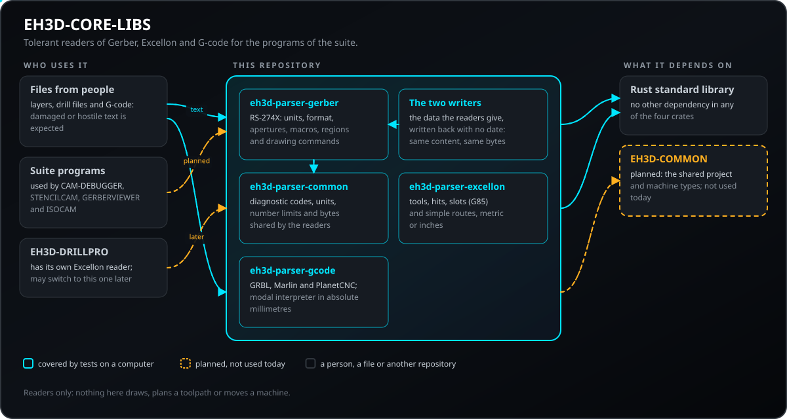
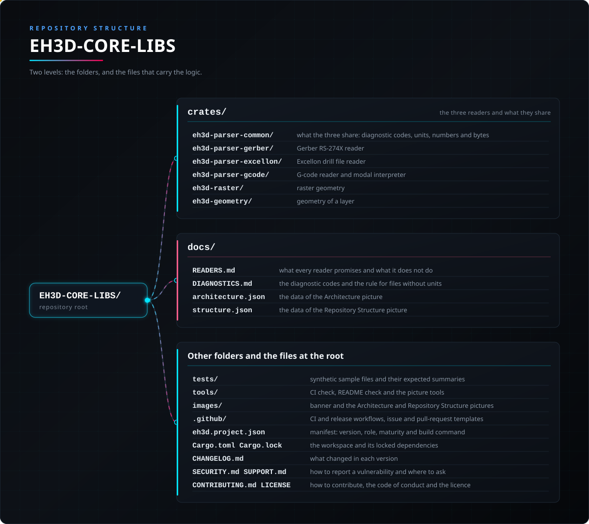

<p align="center">
  
</p>

# 📖 EH3D-CORE-LIBS

<p align="center">🇺🇸 <b>English</b> | <a href="README_spa.md">🇪🇸 Español</a> | <a href="README_fra.md">🇫🇷 Français</a> | <a href="README_ita.md">🇮🇹 Italiano</a> | <a href="README_deu.md">🇩🇪 Deutsch</a> | <a href="README_zho.md">🇨🇳 中文</a> | <a href="README_jpn.md">🇯🇵 日本語</a> | <a href="README_por.md">🇵🇹 Português</a></p>

### The readers of the EH3D Fabrication Suite: Gerber RS-274X, Excellon drill files and G-code, tolerant of damaged files

<p align="center">
  
  
  
  
  
</p>

---

**Honesty check - what actually runs today:** three Rust libraries with no dependencies that read Gerber (RS-274X) layers, Excellon drill files and G-code (a modal interpreter for the GRBL, Marlin and PlanetCNC dialects). 316 tests run on a computer, including damaged and hostile input. Two more libraries write Gerber X2 and Excellon files without dates or versions, so the same content always gives the same bytes; they are tested by writing and reading back with the readers, and no viewer or machine has opened their files yet. The readers never panic and report what they could not understand as diagnostics with line numbers. They draw nothing, compute no toolpath and have not been tried on a collection of real production files; four programs of the suite use them (EH3D-CAM-DEBUGGER, EH3D-STENCILCAM, EH3D-GERBERVIEWER, EH3D-ISOCAM) and nothing here has run on a machine.

---

> **Safety and security status:** these libraries are not a safety system. They read files that other people may send, and they are tested with damaged and hostile input, but a program that was read is **not** a verified program: nothing here decides whether a G-code is safe to run on a machine, and no machine has been controlled with it.

## 📋 At a glance

| | |
|---|---|
| Version | `0.0.8` |
| Maturity | Scaffolding |
| Tests | 316 |
| Stack | Rust |
| On real hardware | Not applicable: file readers, nothing here talks to a machine |

**Jump to:** [Overview](#-overview) · [Architecture](#-architecture) · [Quick start](#-quick-start) · [Testing](#-testing) · [Structure](#-repository-structure) · [Related](#-related-projects)

## 🚦 Project status

Each line is one part of this repository and the light says how far it is today. It is written from what the repository can show (tests, builds, runs), not from what is planned.

🟢 Done and verified · 🟡 Works, with known limits · 🟠 Partly done or not verified yet · 🔴 Not done or not working

| Area | State | What it means here |
|---|---|---|
| Gerber reader | 🟡 | RS-274X: units, coordinate format, apertures, macros, regions and drawing commands are read; only test files so far, not a collection of real production files. |
| Excellon reader | 🟡 | Tools, drill hits, slots and simple routes in metric or inches are read; only test files so far. |
| G-code reader | 🟡 | A modal interpreter for the GRBL, Marlin and PlanetCNC dialects gives absolute millimetres, arcs included; cutter compensation and canned cycles are reported as unsupported. |
| Tests | 🟡 | 316 tests pass (`cargo test`): 43 on Gerber, 42 on Excellon, 79 on G-code and 22 on the shared crate, 17 on the raster geometry, 20 on the shapes, 67 on the pure CAM, 14 on the Gerber writer and 12 on the Excellon writer, with damaged and hostile input and a corpus of synthetic files. |
| Security | 🟡 | Built for files that other people send: nothing panics, no value is guessed and problems come back as diagnostics with line numbers; no independent review, and nothing here judges whether a G-code is safe to run. |
| Geometry and HP-GL | 🔴 | The 2D geometry (offsets, booleans) and the HP-GL and Bungard readers are planned and not built. |
| Use by other programs | 🟡 | Four programs of the suite depend on the readers (EH3D-CAM-DEBUGGER, EH3D-STENCILCAM, EH3D-GERBERVIEWER, EH3D-ISOCAM); none of them has run on a machine. |
| Real hardware | 🟡 | Not applicable: file readers, nothing here talks to a machine. |
| Documentation | 🟡 | README in eight languages and `docs/READERS.md`, which says what each reader promises and what it does not do; `docs/UNIFICATION.md` is the plan to end the two pairs of readers of the suite, which was not carried out: both pairs stay and two differential tests keep them in agreement. |

## 🎯 Overview

* The **Gerber reader** (`eh3d-parser-gerber`, RS-274X): units, the coordinate format with its zero suppression, apertures (circle, rectangle, obround, polygon) and macros, regions, step and repeat, and the drawing commands. A coordinate wider than its format is refused instead of guessed.
* The **Excellon reader** (`eh3d-parser-excellon`): tools with diameter, feed and speed, drill hits, slots (`G85`) and simple routes, in metric or inches, with leading or trailing zero suppression.
* The **G-code reader and interpreter** (`eh3d-parser-gcode`): words, comments, line numbers and Marlin checksums, and the modal state of a controller (units, distance mode, feed, spindle, tool). Every motion comes out in absolute millimetres, arcs included, with the length of the cut, the length of the rapids and the bounding box of the program.
* The **raster geometry** (`eh3d-raster`): units of length (`8mil`, `0.01in`, `0.2mm`), the exact Euclidean distance from every cell of a grid to the nearest occupied cell, and the lines where that distance has a given value, simplified and oriented.
* The **shapes of a layer** (`eh3d-geometry`): discs, rectangles, obrounds, tracks and regions in millimetres with y up, the bounding box of a set of them, and the conversion of Gerber layers and Excellon drill files into them, with a note for everything that is not drawn.
* The **pure CAM** (`eh3d-cam`): the copper drawn on a grid, isolation passes with the checks for gaps the tool cannot cut, forced and fill passes, tolerance and design rule checks, the order and the shortening of paths, alignment on fiducials, board transforms, solder mask openings and old-style Gerber. It reads no file from disk and writes no G-code.
* **Diagnostics instead of failures:** each reader returns lines with a severity (information, warning, error) and the number of the line of the file, and goes on reading.
* **Planned:** the HP-GL and Bungard reader and the 2D geometry (offsets and booleans).

## 🧩 Role in EH3D

EH3D-CORE-LIBS turns files into data for the programs of the suite (isolation, drilling, contour, laser and stencil CAM, and the viewers). It has no screen and no machine control. It is planned to use the types of EH3D-COMMON; today the three readers stand on their own, and EH3D-DRILLPRO still has its own Excellon reader.

## 🏛️ Architecture

<p align="center">
  
</p>

How the parts of this repository fit together: who uses it, what it holds and what it depends on. The picture is drawn from `docs/architecture.json` and checked against the code.

## ✨ Features

* **Zero dependencies:** the three crates use only the Rust standard library.
* **Never panics:** the tests feed every reader empty files, binary garbage, huge numbers, unterminated comments, lines of thousands of characters and every prefix of a valid file.
* **No guessing:** a value that does not fit its declared format is refused as a diagnostic, not rounded into something that looks right.
* **Every command knows its line:** the Gerber operations, the Excellon hits and the G-code blocks carry the line of the file they came from.
* **Arcs done right:** the G-code interpreter handles arcs with `I`/`J` or with `R`, full circles, absolute arc centres, and reports and draws straight an arc that cannot exist.
* **Honest about what it skips:** unsupported features (cutter compensation, canned cycles) are errors and the block moves nothing; `$` system commands of GRBL are skipped with a note.
* **Smaller things readers and writers needed:** a hole of an undefined tool is not kept with a diameter of 0, `parse_with_units` reads a drill file with the units the caller gives, `interpret_with` reads `M3 S0` as the laser off when asked, the `emit` module writes a number and the standard header of a G-code file in one way, `resolution_warning` tells a grid too coarse for the tool, and `Scene::is_lossy` says that something of a file is not in the scene.

## 🔒 Security & Safety

The readers take text from anyone, so the design assumes careless or hostile files. Every row has tests.

| Threat | Defense |
|---|---|
| A damaged, truncated or binary file | no panic: every reader returns a result for any text; the tests cut a valid file at every position and feed garbage |
| A number too wide for its declared format, or an absurd value | refused with an `Error` diagnostic, never rounded or truncated into something plausible |
| A single line of enormous length | the G-code reader cuts a line at 512 characters (`MAX_LINE_CHARS`) and says so |
| A G-code feature the interpreter does not model (cutter compensation, canned cycles) | an `Error` diagnostic, and the block moves nothing, so a program is never silently misread |
| A corrupted Marlin line | the checksum is verified and a bad one is reported |
| An arc that cannot exist (the radius is smaller than half the chord) | reported, and drawn straight |
| Unsafe memory use | the readers are plain safe Rust with no dependencies to audit |

**What is not defended:** a program that was read cleanly is not a verified program. Nothing here checks limits of a machine, tool lengths or collisions, and the readers have had no independent review. Report a vulnerability privately (see [SECURITY.md](SECURITY.md)).

## 🔌 Interfaces

| Crate | Entry points | Result |
|---|---|---|
| `eh3d-parser-gerber` | `parse(text)`, `decode_coordinate(text, format)` | `GerberFile`: units, format, apertures, macros, attributes, `commands`, `ended`, `diagnostics` |
| `eh3d-parser-excellon` | `parse(text)`, `decode_coordinate(...)` | `ExcellonFile`: units, zero suppression, `tools`, `drills`, `slots`, `routes`, `ended`, `diagnostics` |
| `eh3d-parser-gcode` | `parse(text, dialect)`, then `interpret(&program)` | `Program` (blocks) and `Trace` (segments in millimetres, bounding box, cutting and rapid lengths) |
| `eh3d-raster` | `parse_length(text, bare_unit)`, `distance_mm(on, w, h, res)`, then `loops(&grid, level)` | `Unit`, distances in millimetres per cell and closed paths (`Loop`) in millimetres |
| `eh3d-geometry` | `from_gerber(&file)`, `from_excellon(&file)`, then `scene.bounds()` | `Scene` (`Shape` and notes) and `Bounds` in millimetres |
| `eh3d-cam` | `from_scene(&scene, margin, res)`, then `plan(&scene, &plan)` and `close_pieces(...)` | `Bitmap`, `Pass` (closed and open paths in millimetres), `Hole` and the findings of the checks |

All three share `Diagnostic { line, severity, code, message }` with `Severity` `Info`, `Warning` or `Error`, and `is_clean()` to ask whether any `Error` was found. There is no command-line program, no network access and no file access: the callers pass text in and get data out. Each diagnostic has a stable `code` (listed in `docs/DIAGNOSTICS.md`) to filter by kind instead of by text. `parse_bytes` reads a file from its bytes with a size limit (257 MiB) and reads text that is not UTF-8 as Latin-1 with a warning. A Gerber or Excellon file without units is read in millimetres, with a `units-missing` warning. The shared types live in the internal crate `eh3d-parser-common`, which the readers re-export.

## ⚙️ Configuration

The readers have no configuration file. What a caller chooses, and the fixed limits, are these:

| Value | Range | Where |
|---|---|---|
| G-code dialect | `Grbl`, `Marlin` or `PlanetCnc` | the second argument of `parse` |
| Length of a G-code line | up to 512 characters; the rest is cut and reported | `MAX_LINE_CHARS` in `crates/eh3d-parser-gcode/src/lib.rs` |
| Units | taken from the file (`MO` in Gerber, `METRIC` or `INCH` in Excellon, `G20`/`G21` in G-code); the output of G-code is always millimetres | the readers |
| Coordinate format | taken from the file (`FS` in Gerber, `FILE_FORMAT=i:d` or the header in Excellon); a value wider than it is an error | the readers |
| Zero suppression | leading or trailing, as the file says | the readers |

## 🚀 Quick start

You need a stable Rust toolchain (1.75 or newer).

```rust
use eh3d_parser_gcode::{interpret, parse, Dialect};

fn main() {
    let program = parse("G21\nG90\nG1 X10 Y0 F300\nM2\n", Dialect::Grbl);
    let trace = interpret(&program);
    println!("{} mm of cut, clean: {}", trace.cutting_length_mm, program.is_clean());
}
```

```bash
cargo build --release
cargo test
cargo clippy --all-targets -- -D warnings
cargo fmt --check
python -I tools/ci_validate.py
```

## 🧪 Testing

The suite has 316 tests (`cargo test`, run on Windows and Linux in the CI): 43 on Gerber, 42 on Excellon, 79 on G-code and 22 on the crate they share, 17 on the raster geometry, 20 on the shapes, 67 on the pure CAM, 14 on the Gerber writer and 12 on the Excellon writer. A corpus of 21 small synthetic files (`tests/golden/`: Gerber in inches and millimetres, Excellon with `LZ`/`TZ`, slots and routes, G-code for GRBL, Marlin and LinuxCNC, with CRLF, Latin-1 and damaged files) is read by the readers and compared with a summary kept next to each file; `EH3D_REGENERATE=1 cargo test` rewrites the summaries so the change shows in the diff, and the same files are damaged in thousands of ways by the mutation test. They check a typical copper layer and a typical metric file read completely, omitted coordinates, both zero suppressions, slots, routes, inches to millimetres, every command knowing its line, arcs by centre and by radius, full circles, modal feed and motion, Marlin checksums, unsupported features reported instead of guessed, and damaged input: garbage, cut prefixes and very long lines never panic. The CI also runs `cargo fmt --check`, `cargo clippy` with warnings as errors and `python -I tools/ci_validate.py`.

## 🏗️ Build & Release

The version lives in `Cargo.toml` (the workspace), in `eh3d.project.json` and, through the workspace, in each of the three crates; each version has its entry in [CHANGELOG.md](CHANGELOG.md). Releases are published on GitHub; the crates are used from this repository and are not on crates.io.

## 📂 Repository Structure

<p align="center">
  
</p>

<details>
<summary>Text version of the tree</summary>

```text
EH3D-CORE-LIBS/
├── crates/
│   ├── eh3d-parser-common/                      what the three share: diagnostic codes, units, numbers and bytes
│   ├── eh3d-parser-gerber/                      Gerber RS-274X reader
│   ├── eh3d-parser-excellon/                    Excellon drill file reader
│   ├── eh3d-parser-gcode/                       G-code reader and modal interpreter
│   ├── eh3d-raster/                             raster geometry
│   ├── eh3d-geometry/                           geometry of a layer
│   ├── eh3d-cam/                                pure CAM
│   ├── eh3d-writer-gerber/                      Gerber X2 writer
│   └── eh3d-writer-excellon/                    Excellon writer
├── docs/                                        READERS.md, what every reader promises and what it does not do, DIAGNOSTICS.md, the diagnostic codes, and the data of the two pictures
├── tests/                                       synthetic sample files and their expected summaries
├── tools/                                       CI check, README check and the picture tools
├── images/                                      banner and the Architecture and Repository Structure pictures
├── .github/                                     CI and release workflows, issue and pull-request templates
├── eh3d.project.json                            manifest: version, role, maturity and build command
├── Cargo.toml Cargo.lock                        the workspace and its locked dependencies
├── rust-toolchain.toml                          the pinned Rust toolchain
├── CHANGELOG.md                                 what changed in each version
├── SECURITY.md SUPPORT.md                       how to report a vulnerability and where to ask
└── CONTRIBUTING.md CODE_OF_CONDUCT.md LICENSE   how to contribute, the code of conduct and the licence
```

</details>

## 🗺️ Roadmap & Known limits

**Known limits today**

* The readers have only been tried with test files, not with a collection of real production files.
* Cutter radius compensation (`G41`/`G42`) and canned cycles (`G81`..`G89`) are errors; tool length offsets and probing cycles are read but their effect on the position is not tracked; `G92`, `G28`/`G30`, `G53` and `G54`..`G59` are followed only by `interpret_coordinates`; arcs only in the XY plane.
* HP-GL, the Bungard format and the 2D geometry (offsets and booleans) are not built.
* Four programs of the suite use the readers, none of them has run on a machine, and the readers have had no independent review.

**Next**

* Try the three readers on a collection of real files and fix what they show.
* Build the 2D geometry (offsets and booleans) and the HP-GL and Bungard readers.
* Let EH3D-DRILLPRO and the CAM programs use the readers instead of their own.

## 🌍 Languages

README and texts exist in English, Spanish, French, Italian, German, Chinese, Japanese and European Portuguese.

## 🔗 Related Projects

* [EH3D-COMMON](https://github.com/JuanenRac/EH3D-COMMON): the project container and the machine types of the suite; published
* [EH3D-DRILLPRO](https://github.com/JuanenRac/EH3D-DRILLPRO): the drilling program; it has its own Excellon reader today
* [EH3D-ISOCAM](https://github.com/JuanenRac/EH3D-ISOCAM): planned: isolation milling from the Gerber reader
* [EH3D-CAM-DEBUGGER](https://github.com/JuanenRac/EH3D-CAM-DEBUGGER): planned: simulation of the G-code that these readers interpret

## 📚 Documentation

* [What each reader promises](docs/READERS.md): the guarantees, the diagnostics and what is not done.
* [One reader for Gerber and one for Excellon](docs/UNIFICATION.md): the plan to make the readers of this repository and those of EH3D-COMMON one, not carried out: both stay, checked by differential tests.
* [Changelog](CHANGELOG.md)

## 🤝 Contributing & Community

* Before a pull request run `cargo fmt --check`, `cargo clippy --all-targets -- -D warnings`, `cargo test` and `python -I tools/ci_validate.py`: all must pass. See [CONTRIBUTING.md](CONTRIBUTING.md) and the [code of conduct](CODE_OF_CONDUCT.md).
* The README exists in eight languages: a change to the text is made in all eight files, and the two pictures are drawn from `docs/architecture.json` and `docs/structure.json` by `tools/make_architecture.py` and `tools/make_structure.py`.
* A reader must never panic and never guess: a new case needs a test with damaged input, and an unsupported feature is reported, not skipped silently.
* Report a vulnerability privately: [SECURITY.md](SECURITY.md). Questions, ideas and reports: electrohobby3d@gmail.com ([SUPPORT.md](SUPPORT.md)).

## 👤 AUTHOR

**JuanenRac (Electro Hobby 3D)** · electrohobby3d@gmail.com

## 📜 LICENSE

Software: GPL-3.0-or-later. See [LICENSE](LICENSE). Hardware designs of the suite use CERN OHL-S.
