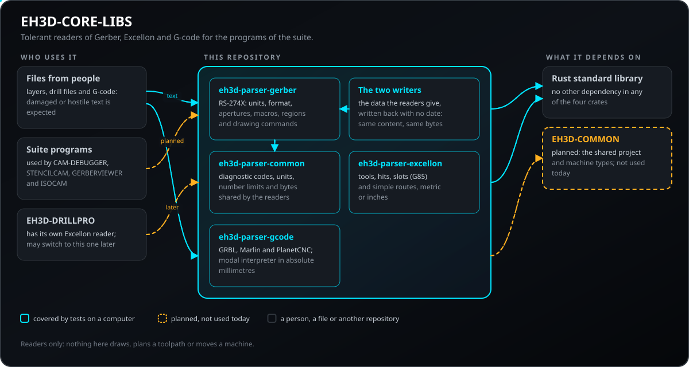
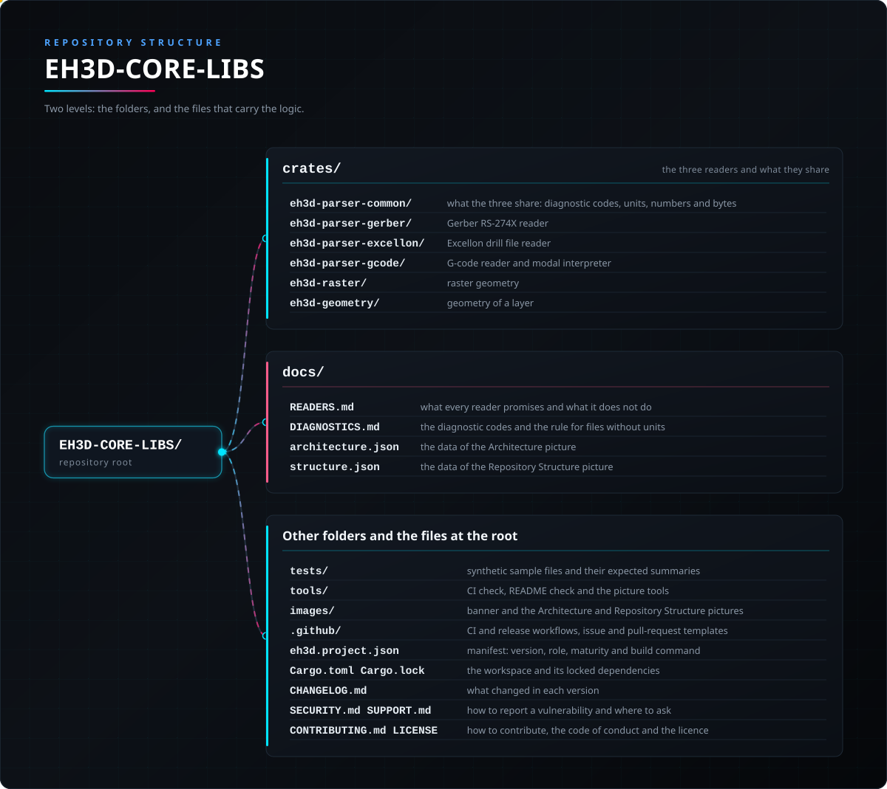

<p align="center">
  
</p>

# 📖 EH3D-CORE-LIBS

<p align="center"><a href="README.md">🇺🇸 English</a> | <a href="README_spa.md">🇪🇸 Español</a> | <a href="README_fra.md">🇫🇷 Français</a> | <a href="README_ita.md">🇮🇹 Italiano</a> | 🇩🇪 <b>Deutsch</b> | <a href="README_zho.md">🇨🇳 中文</a> | <a href="README_jpn.md">🇯🇵 日本語</a> | <a href="README_por.md">🇵🇹 Português</a></p>

### Die Leser der EH3D Fabrication Suite: Gerber RS-274X, Excellon-Bohrdateien und G-Code, tolerant gegenüber beschädigten Dateien

<p align="center">
  
  
  
  
  
</p>

---

**Ehrlichkeitscheck - was heute tatsächlich läuft:** drei Rust-Bibliotheken ohne Abhängigkeiten, die Gerber-Ebenen (RS-274X), Excellon-Bohrdateien und G-Code lesen (ein modaler Interpreter für die Dialekte GRBL, Marlin und PlanetCNC). 316 Tests laufen auf einem Computer, einschließlich beschädigter und feindlicher Eingaben. Zwei weitere Bibliotheken schreiben Gerber-X2- und Excellon-Dateien ohne Datum und Version, sodass gleicher Inhalt immer dieselben Bytes ergibt; sie werden durch Schreiben und Zurücklesen mit den Lesern getestet, und noch kein Betrachter und keine Maschine hat ihre Dateien geöffnet. Die Leser stürzen nie ab und melden, was sie nicht verstehen konnten, als Diagnosen mit Zeilennummern. Sie zeichnen nichts, berechnen keinen Werkzeugweg und wurden nicht mit einer Sammlung echter Produktionsdateien erprobt; vier Programme der Suite nutzen sie (EH3D-CAM-DEBUGGER, EH3D-STENCILCAM, EH3D-GERBERVIEWER, EH3D-ISOCAM), und nichts davon lief auf einer Maschine.

---

> **Stand von Sicherheit und IT-Sicherheit:** diese Bibliotheken sind kein Sicherheitssystem (Safety). Sie lesen Dateien, die andere Personen schicken können, und werden mit beschädigten und feindlichen Eingaben getestet, aber ein gelesenes Programm ist **kein** geprüftes Programm: Nichts hier entscheidet, ob ein G-Code auf einer Maschine sicher ausgeführt werden kann, und mit ihnen wurde keine Maschine gesteuert.

## 📋 Auf einen Blick

| | |
|---|---|
| Version | `0.0.8` |
| Reifegrad | Gerüst |
| Tests | 316 |
| Technologie-Stack | Rust |
| Auf echter Hardware | Nicht zutreffend: Dateileser, nichts hier spricht mit einer Maschine |

**Springe zu:** [Überblick](#-überblick) · [Architektur](#-architektur) · [Schnellstart](#-schnellstart) · [Tests](#-tests) · [Struktur](#-struktur-des-repositorys) · [Verwandte](#-verwandte-projekte)

## 🚦 Projektstatus

Jede Zeile ist ein Teil dieses Repositorys, und die Ampel sagt, wie weit er heute ist. Sie beruht auf dem, was das Repository zeigen kann (Tests, Builds, Läufe), nicht auf dem, was geplant ist.

🟢 Fertig und überprüft · 🟡 Funktioniert, mit bekannten Grenzen · 🟠 Teilweise fertig oder noch nicht überprüft · 🔴 Nicht gemacht oder funktioniert nicht

| Bereich | Stand | Was das hier bedeutet |
|---|---|---|
| Gerber-Leser | 🟡 | RS-274X: Einheiten, Koordinatenformat, Blenden, Makros, Regionen und Zeichenbefehle werden gelesen; bisher nur Testdateien, keine Sammlung echter Produktionsdateien. |
| Excellon-Leser | 🟡 | Werkzeuge, Bohrungen, Langlöcher und einfache Fräswege in metrisch oder Zoll werden gelesen; bisher nur Testdateien. |
| G-Code-Leser | 🟡 | Ein modaler Interpreter für die Dialekte GRBL, Marlin und PlanetCNC liefert absolute Millimeter, Bögen eingeschlossen; Fräserradiuskorrektur und Bearbeitungszyklen werden als nicht unterstützt gemeldet. |
| Tests | 🟡 | 316 Tests bestehen (`cargo test`): 43 für Gerber, 42 für Excellon, 79 für G-Code und 22 für das gemeinsame Crate, 17 für die Raster-Geometrie, 20 für die Formen, 67 für die reine CAM, 14 für den Gerber-Schreiber und 12 für den Excellon-Schreiber, mit beschädigten und feindlichen Eingaben und einem Korpus synthetischer Dateien. |
| Sicherheit | 🟡 | Gebaut für Dateien, die andere Personen schicken: nichts stürzt ab, kein Wert wird geraten, und Probleme kommen als Diagnosen mit Zeilennummern zurück; keine unabhängige Prüfung, und nichts hier beurteilt, ob ein G-Code sicher ausführbar ist. |
| Geometrie und HP-GL | 🔴 | Die 2D-Geometrie (Offsets, Boolesche Operationen) und die Leser für HP-GL und Bungard sind geplant und nicht gebaut. |
| Nutzung durch andere Programme | 🟡 | Vier Programme der Suite hängen von den Lesern ab (EH3D-CAM-DEBUGGER, EH3D-STENCILCAM, EH3D-GERBERVIEWER, EH3D-ISOCAM); keines lief auf einer Maschine. |
| Echte Hardware | 🟡 | Nicht zutreffend: Dateileser, nichts hier spricht mit einer Maschine. |
| Dokumentation | 🟡 | README in acht Sprachen und `docs/READERS.md`, das sagt, was jeder Leser verspricht und was er nicht tut; `docs/UNIFICATION.md` ist der Plan, die zwei Leserpaare der Suite zu beenden, der nicht umgesetzt wurde: beide Paare bleiben und zwei Differenztests halten sie in Übereinstimmung. |

## 🎯 Überblick

* Der **Gerber-Leser** (`eh3d-parser-gerber`, RS-274X): Einheiten, das Koordinatenformat mit seiner Nullunterdrückung, Blenden (Kreis, Rechteck, Obround, Polygon) und Makros, Regionen, Step-and-Repeat und die Zeichenbefehle. Eine Koordinate, die breiter als ihr Format ist, wird abgewiesen statt geraten.
* Der **Excellon-Leser** (`eh3d-parser-excellon`): Werkzeuge mit Durchmesser, Vorschub und Drehzahl, Bohrungen, Langlöcher (`G85`) und einfache Fräswege, metrisch oder in Zoll, mit führender oder nachgestellter Nullunterdrückung.
* Der **G-Code-Leser und -Interpreter** (`eh3d-parser-gcode`): Wörter, Kommentare, Zeilennummern und Marlin-Prüfsummen sowie der modale Zustand einer Steuerung (Einheiten, Maßangabe, Vorschub, Spindel, Werkzeug). Jede Bewegung kommt in absoluten Millimetern heraus, Bögen eingeschlossen, mit Schnittlänge, Eilganglänge und Hüllquader des Programms.
* Die **Raster-Geometrie** (`eh3d-raster`): Längeneinheiten (`8mil`, `0.01in`, `0.2mm`), der exakte euklidische Abstand jeder Zelle eines Rasters zur nächsten belegten Zelle und die Linien, auf denen dieser Abstand einen bestimmten Wert hat, vereinfacht und ausgerichtet.
* Die **Formen einer Lage** (`eh3d-geometry`): Kreise, Rechtecke, Langlöcher, Leiterbahnen und Flächen in Millimetern mit y nach oben, der Umgebungsrahmen einer Menge davon und die Umwandlung von Gerber-Lagen und Excellon-Bohrdateien in sie, mit einem Hinweis für alles, was nicht gezeichnet wird.
* Das **reine CAM** (`eh3d-cam`): das Kupfer auf einem Raster, Isolationsbahnen mit den Prüfungen auf Lücken, die das Werkzeug nicht schneiden kann, erzwungene und Füllbahnen, Toleranz- und Entwurfsregelprüfungen, die Reihenfolge und das Kürzen der Pfade, die Ausrichtung an Passmarken, Platinentransformationen, Lötstopp-Öffnungen und alte Gerber-Dateien. Es liest keine Datei von der Platte und schreibt keinen G-Code.
* **Diagnosen statt Fehlschlägen:** Jeder Leser liefert Zeilen mit einer Schwere (Information, Warnung, Fehler) und der Zeilennummer der Datei und liest weiter.
* **Geplant:** der HP-GL- und Bungard-Leser und die 2D-Geometrie (Offsets und Boolesche Operationen).

## 🧩 Rolle in EH3D

EH3D-CORE-LIBS verwandelt Dateien in Daten für die Programme der Suite (CAM für Isolation, Bohren, Kontur, Laser und Schablone sowie die Betrachter). Es hat keinen Bildschirm und keine Maschinensteuerung. Es soll die Typen von EH3D-COMMON nutzen; heute stehen die drei Leser für sich, und EH3D-DRILLPRO hat noch seinen eigenen Excellon-Leser.

## 🏛️ Architektur

<p align="center">
  
</p>

Wie die Teile dieses Repositorys zusammenpassen: wer es nutzt, was es enthält und wovon es abhängt. Das Bild wird aus `docs/architecture.json` gezeichnet und gegen den Code geprüft.

## ✨ Funktionen

* **Keine Abhängigkeiten:** Die drei Crates nutzen nur die Rust-Standardbibliothek.
* **Stürzt nie ab:** Die Tests füttern jeden Leser mit leeren Dateien, Binärmüll, riesigen Zahlen, nicht geschlossenen Kommentaren, Zeilen mit Tausenden Zeichen und jedem Präfix einer gültigen Datei.
* **Kein Raten:** Ein Wert, der nicht in sein deklariertes Format passt, wird als Diagnose abgewiesen, nicht zu etwas Plausiblem gerundet.
* **Jeder Befehl kennt seine Zeile:** Die Gerber-Operationen, Excellon-Bohrungen und G-Code-Blöcke tragen die Zeile der Datei, aus der sie stammen.
* **Bögen richtig:** Der G-Code-Interpreter behandelt Bögen mit `I`/`J` oder mit `R`, Vollkreise und absolute Bogenmittelpunkte und meldet einen Bogen, der nicht existieren kann, und zeichnet ihn gerade.
* **Ehrlich bei Übersprungenem:** Nicht unterstützte Funktionen (Fräserradiuskorrektur, Bearbeitungszyklen) sind Fehler, und der Block bewegt nichts; die `$`-Systembefehle von GRBL werden mit einem Hinweis übersprungen.
* **Kleinigkeiten, die Leser und Schreiber brauchten:** ein Loch eines undefinierten Werkzeugs wird nicht mit Durchmesser 0 behalten, `parse_with_units` liest eine Bohrdatei mit den vom Aufrufer genannten Einheiten, `interpret_with` liest auf Wunsch `M3 S0` als ausgeschalteten Laser, das Modul `emit` schreibt eine Zahl und den Standardkopf einer G-Code-Datei auf eine einzige Art, `resolution_warning` meldet ein für das Werkzeug zu grobes Raster, und `Scene::is_lossy` sagt, dass etwas aus einer Datei nicht in der Szene ist.

## 🔒 Sicherheit und Schutz

Die Leser nehmen Text von jedem entgegen, daher geht der Entwurf von nachlässigen oder feindlichen Dateien aus. Jede Zeile hat Tests.

| Bedrohung | Abwehr |
|---|---|
| Eine beschädigte, abgeschnittene oder binäre Datei | kein Absturz: Jeder Leser liefert für jeden Text ein Ergebnis; die Tests schneiden eine gültige Datei an jeder Stelle ab und füttern Müll |
| Eine Zahl, die für ihr deklariertes Format zu breit ist, oder ein absurder Wert | wird mit einer `Error`-Diagnose abgewiesen, nie gerundet oder zu etwas Plausiblem gekürzt |
| Eine einzelne extrem lange Zeile | Der G-Code-Leser kürzt eine Zeile bei 512 Zeichen (`MAX_LINE_CHARS`) und sagt es |
| Eine G-Code-Funktion, die der Interpreter nicht abbildet (Fräserradiuskorrektur, Bearbeitungszyklen) | eine `Error`-Diagnose, und der Block bewegt nichts, sodass ein Programm nie stillschweigend falsch gelesen wird |
| Eine beschädigte Marlin-Zeile | Die Prüfsumme wird geprüft, und eine falsche wird gemeldet |
| Ein Bogen, der nicht existieren kann (Radius kleiner als die halbe Sehne) | wird gemeldet und gerade gezeichnet |
| Unsichere Speichernutzung | Die Leser sind einfaches sicheres Rust ohne Abhängigkeiten, die geprüft werden müssten |

**Was nicht abgewehrt wird:** Ein sauber gelesenes Programm ist kein geprüftes Programm. Nichts hier prüft Maschinengrenzen, Werkzeuglängen oder Kollisionen, und die Leser wurden nicht unabhängig geprüft. Melde eine Schwachstelle privat (siehe [SECURITY.md](SECURITY.md)).

## 🔌 Schnittstellen

| Crate | Einstiegspunkte | Ergebnis |
|---|---|---|
| `eh3d-parser-gerber` | `parse(text)`, `decode_coordinate(text, format)` | `GerberFile`: Einheiten, Format, Blenden, Makros, Attribute, `commands`, `ended`, `diagnostics` |
| `eh3d-parser-excellon` | `parse(text)`, `decode_coordinate(...)` | `ExcellonFile`: Einheiten, Nullunterdrückung, `tools`, `drills`, `slots`, `routes`, `ended`, `diagnostics` |
| `eh3d-parser-gcode` | `parse(text, dialect)`, dann `interpret(&program)` | `Program` (Blöcke) und `Trace` (Segmente in Millimetern, Hüllquader, Schnitt- und Eilganglängen) |
| `eh3d-raster` | `parse_length(text, bare_unit)`, `distance_mm(on, w, h, res)`, dann `loops(&grid, level)` | `Unit`, Abstände in Millimetern je Zelle und geschlossene Pfade (`Loop`) in Millimetern |
| `eh3d-geometry` | `from_gerber(&file)`, `from_excellon(&file)`, dann `scene.bounds()` | `Scene` (`Shape` und Hinweise) und `Bounds` in Millimetern |
| `eh3d-cam` | `from_scene(&scene, margin, res)`, dann `plan(&scene, &plan)` und `close_pieces(...)` | `Bitmap`, `Pass` (geschlossene und offene Pfade in Millimetern), `Hole` und die Befunde der Prüfungen |

Alle drei teilen `Diagnostic { line, severity, code, message }` mit `Severity` `Info`, `Warning` oder `Error` und `is_clean()`, um zu fragen, ob ein `Error` gefunden wurde. Es gibt kein Kommandozeilenprogramm, keinen Netzwerkzugriff und keinen Dateizugriff: Aufrufer übergeben Text und bekommen Daten zurück. Jeder Hinweis hat einen stabilen `code` (aufgelistet in `docs/DIAGNOSTICS.md`), um nach Art statt nach Text zu filtern. `parse_bytes` liest eine Datei aus ihren Bytes mit einer Größenbegrenzung (257 MiB) und liest Text, der nicht UTF-8 ist, als Latin-1 mit einer Warnung. Eine Gerber- oder Excellon-Datei ohne Einheiten wird in Millimetern gelesen, mit der Warnung `units-missing`. Die gemeinsamen Typen liegen im internen Crate `eh3d-parser-common`, das die Leser erneut exportieren.

## ⚙️ Konfiguration

Die Leser haben keine Konfigurationsdatei. Was der Aufrufer wählt, und die festen Grenzen sind diese:

| Wert | Bereich | Wo |
|---|---|---|
| G-Code-Dialekt | `Grbl`, `Marlin` oder `PlanetCnc` | das zweite Argument von `parse` |
| Länge einer G-Code-Zeile | bis 512 Zeichen; der Rest wird abgeschnitten und gemeldet | `MAX_LINE_CHARS` in `crates/eh3d-parser-gcode/src/lib.rs` |
| Einheiten | aus der Datei übernommen (`MO` bei Gerber, `METRIC` oder `INCH` bei Excellon, `G20`/`G21` bei G-Code); die G-Code-Ausgabe ist immer in Millimetern | die Leser |
| Koordinatenformat | aus der Datei übernommen (`FS` bei Gerber, `FILE_FORMAT=i:d` oder der Kopf bei Excellon); ein breiterer Wert ist ein Fehler | die Leser |
| Nullunterdrückung | führend oder nachgestellt, wie die Datei es sagt | die Leser |

## 🚀 Schnellstart

Du brauchst eine stabile Rust-Toolchain (1.75 oder neuer).

```rust
use eh3d_parser_gcode::{interpret, parse, Dialect};

fn main() {
    let program = parse("G21\nG90\nG1 X10 Y0 F300\nM2\n", Dialect::Grbl);
    let trace = interpret(&program);
    println!("{} mm of cut, clean: {}", trace.cutting_length_mm, program.is_clean());
}
```

```bash
cargo build --release
cargo test
cargo clippy --all-targets -- -D warnings
cargo fmt --check
python -I tools/ci_validate.py
```

## 🧪 Tests

Die Suite hat 316 Tests (`cargo test`, in der CI unter Windows und Linux ausgeführt): 43 für Gerber, 42 für Excellon, 79 für G-Code und 22 für das gemeinsame Crate, 17 für die Raster-Geometrie, 20 für die Formen, 67 für die reine CAM, 14 für den Gerber-Schreiber und 12 für den Excellon-Schreiber. Ein Korpus aus 21 kleinen synthetischen Dateien (`tests/golden/`: Gerber in Zoll und Millimetern, Excellon mit `LZ`/`TZ`, Langlöchern und Fräsbahnen, G-Code für GRBL, Marlin und LinuxCNC, mit CRLF, Latin-1 und beschädigten Dateien) wird von den Lesern gelesen und mit einer neben jeder Datei gespeicherten Zusammenfassung verglichen; `EH3D_REGENERATE=1 cargo test` schreibt die Zusammenfassungen neu, damit die Änderung im Diff sichtbar ist, und dieselben Dateien werden vom Mutationstest auf tausendfache Weise beschädigt. Sie prüfen, dass eine typische Kupferebene und eine typische metrische Datei vollständig gelesen werden, ausgelassene Koordinaten, beide Nullunterdrückungen, Langlöcher, Fräswege, Zoll zu Millimeter, dass jeder Befehl seine Zeile kennt, Bögen nach Mittelpunkt und nach Radius, Vollkreise, modalen Vorschub und modale Bewegung, Marlin-Prüfsummen, nicht unterstützte Funktionen, die gemeldet statt geraten werden, und beschädigte Eingaben: Müll, abgeschnittene Präfixe und sehr lange Zeilen führen nie zum Absturz. Die CI führt außerdem `cargo fmt --check`, `cargo clippy` mit Warnungen als Fehlern und `python -I tools/ci_validate.py` aus.

## 🏗️ Build und Veröffentlichung

Die Version steht in `Cargo.toml` (dem Workspace), in `eh3d.project.json` und über den Workspace in jedem der drei Crates; jede Version hat ihren Eintrag in [CHANGELOG.md](CHANGELOG.md). Releases werden auf GitHub veröffentlicht; die Crates werden aus diesem Repository genutzt und liegen nicht auf crates.io.

## 📂 Struktur des Repositorys

<p align="center">
  
</p>

<details>
<summary>Textversion des Baums</summary>

```text
EH3D-CORE-LIBS/
├── crates/
│   ├── eh3d-parser-common/                      was die drei teilen: Hinweiscodes, Einheiten, Zahlen und Bytes
│   ├── eh3d-parser-gerber/                      Gerber-RS-274X-Leser
│   ├── eh3d-parser-excellon/                    Leser für Excellon-Bohrdateien
│   ├── eh3d-parser-gcode/                       G-Code-Leser und modaler Interpreter
│   ├── eh3d-raster/                             Raster-Geometrie
│   ├── eh3d-geometry/                           Geometrie einer Lage
│   ├── eh3d-cam/                                reine CAM
│   ├── eh3d-writer-gerber/                      Gerber-X2-Schreiber
│   └── eh3d-writer-excellon/                    Excellon-Schreiber
├── docs/                                        READERS.md, was jeder Leser verspricht und was nicht, DIAGNOSTICS.md, die Hinweiscodes, und die Daten der beiden Bilder
├── tests/                                       synthetische Beispieldateien und ihre erwarteten Zusammenfassungen
├── tools/                                       CI-Prüfung, README-Prüfung und die Bildwerkzeuge
├── images/                                      Banner und die Bilder von Architektur und Repository-Struktur
├── .github/                                     CI- und Release-Workflows, Vorlagen für Issues und Pull Requests
├── eh3d.project.json                            Manifest: Version, Rolle, Reifegrad und Build-Befehl
├── Cargo.toml Cargo.lock                        der Workspace und seine festgelegten Abhängigkeiten
├── rust-toolchain.toml                          die festgelegte Rust-Toolchain
├── CHANGELOG.md                                 was sich in jeder Version geändert hat
├── SECURITY.md SUPPORT.md                       Schwachstellen melden und Fragen stellen
└── CONTRIBUTING.md CODE_OF_CONDUCT.md LICENSE   Mitwirken, Verhaltenskodex und Lizenz
```

</details>

## 🗺️ Roadmap und bekannte Grenzen

**Bekannte Grenzen heute**

* Die Leser wurden nur mit Testdateien erprobt, nicht mit einer Sammlung echter Produktionsdateien.
* Fräserradiuskorrektur (`G41`/`G42`) und Bearbeitungszyklen (`G81`..`G89`) sind Fehler; Werkzeuglängenkorrekturen und Tastzyklen werden gelesen, ihre Wirkung auf die Position wird aber nicht verfolgt; `G92`, `G28`/`G30`, `G53` und `G54`..`G59` verfolgt nur `interpret_coordinates`; Bögen nur in der XY-Ebene.
* HP-GL, das Bungard-Format und die 2D-Geometrie (Offsets und Boolesche Operationen) sind nicht gebaut.
* Vier Programme der Suite nutzen die Leser, keines lief auf einer Maschine, und die Leser wurden nicht unabhängig geprüft.

**Als Nächstes**

* Die drei Leser an einer Sammlung echter Dateien erproben und beheben, was sich zeigt.
* Die 2D-Geometrie (Offsets und Boolesche Operationen) und die Leser für HP-GL und Bungard bauen.
* EH3D-DRILLPRO und die CAM-Programme die Leser statt ihrer eigenen nutzen lassen.

## 🌍 Sprachen

README und Texte gibt es auf Englisch, Spanisch, Französisch, Italienisch, Deutsch, Chinesisch, Japanisch und europäischem Portugiesisch.

## 🔗 Verwandte Projekte

* [EH3D-COMMON](https://github.com/JuanenRac/EH3D-COMMON): der Projektcontainer und die Maschinentypen der Suite; veröffentlicht
* [EH3D-DRILLPRO](https://github.com/JuanenRac/EH3D-DRILLPRO): das Bohrprogramm; es hat heute seinen eigenen Excellon-Leser
* [EH3D-ISOCAM](https://github.com/JuanenRac/EH3D-ISOCAM): geplant: Isolationsfräsen aus dem Gerber-Leser
* [EH3D-CAM-DEBUGGER](https://github.com/JuanenRac/EH3D-CAM-DEBUGGER): geplant: Simulation des G-Codes, den diese Leser interpretieren

## 📚 Dokumentation

* [Was jeder Leser verspricht](docs/READERS.md): die Zusagen, die Diagnosen und was nicht getan wird.
* [Ein Leser für Gerber und einer für Excellon](docs/UNIFICATION.md): der Plan, die Leser dieses Repositorys und die von EH3D-COMMON zu einem zu machen, nicht umgesetzt: beide bleiben, durch Differenztests geprüft.
* [Änderungsprotokoll](CHANGELOG.md)

## 🤝 Mitwirken und Community

* Führe vor einem Pull Request `cargo fmt --check`, `cargo clippy --all-targets -- -D warnings`, `cargo test` und `python -I tools/ci_validate.py` aus: alles muss bestehen. Siehe [CONTRIBUTING.md](CONTRIBUTING.md) und den [Verhaltenskodex](CODE_OF_CONDUCT.md).
* Das README gibt es in acht Sprachen: Eine Textänderung wird in allen acht Dateien gemacht, und die beiden Bilder werden aus `docs/architecture.json` und `docs/structure.json` mit `tools/make_architecture.py` und `tools/make_structure.py` gezeichnet.
* Ein Leser darf nie abstürzen und nie raten: Ein neuer Fall braucht einen Test mit beschädigter Eingabe, und eine nicht unterstützte Funktion wird gemeldet, nicht stillschweigend übersprungen.
* Melde eine Schwachstelle privat: [SECURITY.md](SECURITY.md). Fragen, Ideen und Meldungen: electrohobby3d@gmail.com ([SUPPORT.md](SUPPORT.md)).

## 👤 AUTOR

**JuanenRac (Electro Hobby 3D)** · electrohobby3d@gmail.com

## 📜 LIZENZ

Software: GPL-3.0-or-later. Siehe [LICENSE](LICENSE). Die Hardware-Entwürfe der Suite verwenden die CERN OHL-S.
