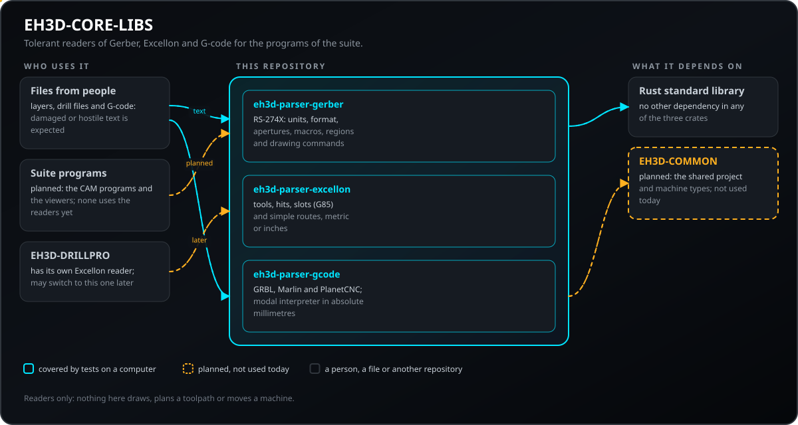
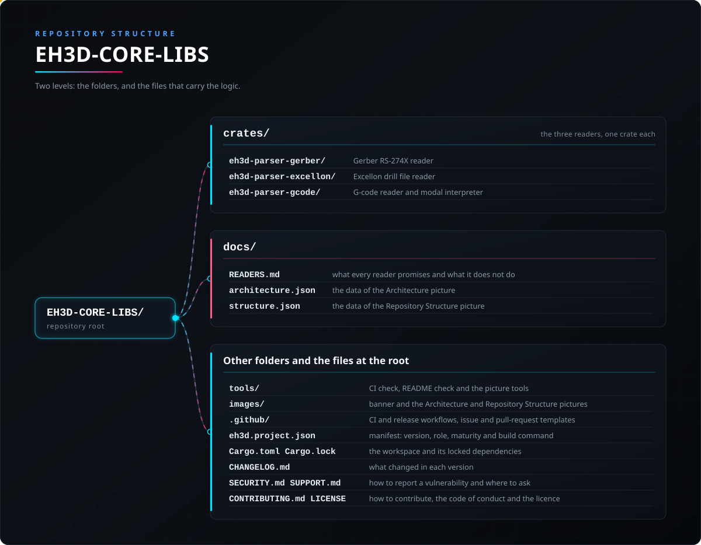

<p align="center">
  
</p>

# 📖 EH3D-CORE-LIBS

<p align="center"><a href="README.md">🇺🇸 English</a> | <a href="README_spa.md">🇪🇸 Español</a> | <a href="README_fra.md">🇫🇷 Français</a> | <a href="README_ita.md">🇮🇹 Italiano</a> | <a href="README_deu.md">🇩🇪 Deutsch</a> | <a href="README_zho.md">🇨🇳 中文</a> | 🇯🇵 <b>日本語</b> | <a href="README_por.md">🇵🇹 Português</a></p>

### EH3D Fabrication Suite のリーダー：Gerber RS-274X、Excellon ドリル ファイル、G コード。壊れたファイルにも寛容です

<p align="center">
  
  
  
  
  
</p>

---

**正直さの確認 - 今日実際に動くもの：** 依存関係のない 3 つの Rust ライブラリで、Gerber（RS-274X）レイヤー、Excellon ドリル ファイル、G コード（GRBL・Marlin・PlanetCNC 方言のモーダル インタープリター）を読みます。壊れた入力や悪意ある入力を含む 42 件のテストがコンピューター上で動きます。リーダーはパニックせず、理解できなかった内容を行番号付きの診断として報告します。描画も工具経路の計算もせず、実際の製造ファイルの集まりでは試していません。スイートのどのプログラムもまだ使っておらず、機械で動かしたこともありません。

---

> **安全性とセキュリティの現状：** これらのライブラリは安全装置ではありません。他人から送られる可能性のあるファイルを読み、壊れた入力や悪意ある入力でテストしていますが、読み込めたプログラムが検証済みのプログラムであるわけでは**ありません**。G コードを機械で安全に実行できるかどうかをここで判断することはなく、これで機械を制御したこともありません。

## 📋 ひと目で

| | |
|---|---|
| バージョン | `0.0.1` |
| 成熟度 | 足場 |
| テスト | 42 |
| 技術スタック | Rust |
| 実機での動作 | 該当なし：ファイル リーダーで、機械とは通信しません |

**移動先：** [概要](#-概要) · [アーキテクチャ](#-アーキテクチャ) · [クイックスタート](#-クイックスタート) · [テスト](#-テスト) · [構成](#-リポジトリの構成) · [関連](#-関連プロジェクト)

## 🚦 プロジェクトの状況

各行はこのリポジトリの一部分で、信号は今日どこまで進んでいるかを示します。計画ではなく、リポジトリが示せるもの（テスト、ビルド、実行）に基づいて書かれています。

🟢 完了・検証済み · 🟡 動作する（既知の制限あり） · 🟠 一部のみ、または未検証 · 🔴 未実装または動作しない

| 領域 | 状態 | ここでの意味 |
|---|---|---|
| Gerber リーダー | 🟡 | RS-274X：単位、座標フォーマット、アパーチャ、マクロ、リージョン、描画コマンドを読みます。今のところテスト ファイルのみで、実際の製造ファイルの集まりでは試していません。 |
| Excellon リーダー | 🟡 | 工具、穴、スロット、単純なルートをメートル法またはインチで読みます。今のところテスト ファイルのみです。 |
| G コード リーダー | 🟡 | GRBL・Marlin・PlanetCNC 方言のモーダル インタープリターが、円弧を含む絶対ミリメートルを出力します。工具径補正と固定サイクルは未対応として報告されます。 |
| テスト | 🟡 | 42 件のテストが通ります（`cargo test`）：Gerber 12 件とモジュール内 1 件、Excellon 11 件、G コード 18 件。壊れた入力や悪意ある入力を含みます。 |
| セキュリティ | 🟡 | 他人から送られるファイルを前提に作られています。パニックせず、値を推測せず、問題は行番号付きの診断として返ります。独立したレビューはなく、G コードが安全に実行できるかの判断はここではしません。 |
| ジオメトリと HP-GL | 🔴 | 2D ジオメトリ（オフセット、ブーリアン）と HP-GL・Bungard リーダーは計画のみで、未作成です。 |
| 他のプログラムでの利用 | 🔴 | スイートのどのプログラムも、まだこれらのリーダーに依存していません。 |
| 実機 | 🟡 | 該当なし：ファイル リーダーで、機械とは通信しません。 |
| ドキュメント | 🟡 | 8 言語の README と、各リーダーが約束することとしないことを記した `docs/READERS.md`。 |

## 🎯 概要

* **Gerber リーダー**（`eh3d-parser-gerber`、RS-274X）：単位、ゼロ省略を含む座標フォーマット、アパーチャ（円、長方形、小判、多角形）とマクロ、リージョン、ステップ＆リピート、描画コマンド。フォーマットより桁数の多い座標は、推測せずに拒否します。
* **Excellon リーダー**（`eh3d-parser-excellon`）：直径・送り・回転数を持つ工具、穴、スロット（`G85`）、単純なルートを、メートル法またはインチで、先頭または末尾のゼロ省略に対応して読みます。
* **G コード リーダー兼インタープリター**（`eh3d-parser-gcode`）：ワード、コメント、行番号、Marlin のチェックサム、コントローラーのモーダル状態（単位、距離モード、送り、スピンドル、工具）。すべての動きは円弧を含む絶対ミリメートルで出力され、切削長、早送り長、プログラムの外接ボックスも得られます。
* **失敗ではなく診断：** 各リーダーは重大度（情報、警告、エラー）とファイルの行番号を持つ行を返し、読み続けます。
* **計画中：** HP-GL と Bungard のリーダー、2D ジオメトリ（オフセットとブーリアン）。

## 🧩 EH3D での役割

EH3D-CORE-LIBS は、ファイルをスイートのプログラム（アイソレーション、ドリル、輪郭、レーザー、ステンシルの CAM とビューアー）が使うデータに変換します。画面も機械制御もありません。EH3D-COMMON の型を使う予定ですが、現在は 3 つのリーダーが単独で動き、EH3D-DRILLPRO はまだ独自の Excellon リーダーを持っています。

## 🏛️ アーキテクチャ

<p align="center">
  
</p>

このリポジトリの各部分の関係：誰が使い、何を持ち、何に依存するか。図は `docs/architecture.json` から描かれ、コードと照合されます。

## ✨ 機能

* **依存関係ゼロ：** 3 つのクレートは Rust の標準ライブラリだけを使います。
* **パニックしない：** テストでは、空のファイル、バイナリのゴミ、巨大な数値、閉じていないコメント、数千文字の行、有効なファイルのあらゆる先頭部分を各リーダーに与えます。
* **推測しない：** 宣言されたフォーマットに収まらない値は、それらしく丸めずに診断として拒否します。
* **すべてのコマンドが行番号を知っている：** Gerber の操作、Excellon の穴、G コードのブロックは、元のファイルの行番号を持ちます。
* **円弧を正しく：** G コード インタープリターは `I`/`J` または `R` の円弧、完全な円、絶対指定の円弧中心を扱い、存在し得ない円弧は報告して直線で描きます。
* **省略した内容について正直：** 未対応の機能（工具径補正、固定サイクル）はエラーとなりブロックは何も動かしません。GRBL の `$` システム コマンドは注記付きで読み飛ばします。

## 🔒 セキュリティと安全

リーダーは誰からのテキストでも受け取るため、設計は不注意または悪意のあるファイルを前提にしています。各行にテストがあります。

| 脅威 | 防御 |
|---|---|
| 壊れた、途中で切れた、またはバイナリのファイル | パニックなし：どんなテキストでも結果を返します。テストは有効なファイルをあらゆる位置で切り、ゴミを与えます |
| 宣言されたフォーマットに対して桁数が多すぎる数値、または異常な値 | `Error` 診断で拒否し、もっともらしい値に丸めたり切り詰めたりしません |
| 極端に長い 1 行 | G コード リーダーは 1 行を 512 文字（`MAX_LINE_CHARS`）で切り、その旨を報告します |
| インタープリターが扱わない G コード機能（工具径補正、固定サイクル） | `Error` 診断とし、そのブロックは何も動かさないため、プログラムが黙って誤読されることはありません |
| 壊れた Marlin の行 | チェックサムを検証し、不一致を報告します |
| 存在し得ない円弧（半径が弦の半分より小さい） | 報告し、直線で描きます |
| 危険なメモリ使用 | リーダーは依存関係のない安全な Rust だけで書かれ、監査すべき依存先がありません |

**防御していないこと：** 問題なく読めたプログラムは、検証済みのプログラムではありません。機械の限界、工具長、衝突の確認はここでは行わず、リーダーは独立したレビューを受けていません。脆弱性は非公開で報告してください（[SECURITY.md](SECURITY.md) 参照）。

## 🔌 インターフェース

| クレート | 入口 | 結果 |
|---|---|---|
| `eh3d-parser-gerber` | `parse(text)`、`decode_coordinate(text, format)` | `GerberFile`：単位、フォーマット、アパーチャ、マクロ、属性、`commands`、`ended`、`diagnostics` |
| `eh3d-parser-excellon` | `parse(text)`、`decode_coordinate(...)` | `ExcellonFile`：単位、ゼロ省略、`tools`、`drills`、`slots`、`routes`、`ended`、`diagnostics` |
| `eh3d-parser-gcode` | `parse(text, dialect)` のあと `interpret(&program)` | `Program`（ブロック）と `Trace`（ミリメートルのセグメント、外接ボックス、切削長と早送り長） |

3 つとも `Diagnostic { line, severity, message }`（`Severity` は `Info`、`Warning`、`Error`）と、`Error` があったかを尋ねる `is_clean()` を共有します。コマンドライン プログラム、ネットワーク アクセス、ファイル アクセスはなく、呼び出し側がテキストを渡してデータを受け取ります。

## ⚙️ 設定

リーダーに設定ファイルはありません。呼び出し側が選べるものと固定の上限は次のとおりです。

| 値 | 範囲 | 場所 |
|---|---|---|
| G コードの方言 | `Grbl`、`Marlin`、`PlanetCnc` | `parse` の第 2 引数 |
| G コード 1 行の長さ | 最大 512 文字。超えた分は切られ、報告されます | `crates/eh3d-parser-gcode/src/lib.rs` の `MAX_LINE_CHARS` |
| 単位 | ファイルから取得（Gerber は `MO`、Excellon は `METRIC` または `INCH`、G コードは `G20`/`G21`）。G コードの出力は常にミリメートル | リーダー |
| 座標フォーマット | ファイルから取得（Gerber は `FS`、Excellon は `FILE_FORMAT=i:d` またはヘッダー）。それより長い値はエラー | リーダー |
| ゼロ省略 | ファイルの指定に従い、先頭または末尾 | リーダー |

## 🚀 クイックスタート

安定版の Rust ツールチェーン（1.75 以降）が必要です。

```rust
use eh3d_parser_gcode::{interpret, parse, Dialect};

fn main() {
    let program = parse("G21\nG90\nG1 X10 Y0 F300\nM2\n", Dialect::Grbl);
    let trace = interpret(&program);
    println!("{} mm of cut, clean: {}", trace.cutting_length_mm, program.is_clean());
}
```

```bash
cargo build --release
cargo test
cargo clippy --all-targets -- -D warnings
cargo fmt --check
python -I tools/ci_validate.py
```

## 🧪 テスト

テストは 42 件です（`cargo test`、CI では Windows と Linux で実行）。Gerber 12 件（モジュール内 1 件を別に含む）、Excellon 11 件、G コード 18 件です。典型的な銅箔レイヤーとメートル法ファイルが完全に読めること、省略された座標、2 種類のゼロ省略、スロット、ルート、インチからミリメートルへの変換、すべてのコマンドが行番号を持つこと、中心指定と半径指定の円弧、完全な円、モーダルな送りと動作、Marlin のチェックサム、未対応機能が推測されず報告されること、そして壊れた入力（ゴミ、切り取った先頭部分、非常に長い行でもパニックしない）を検査します。CI は `cargo fmt --check`、警告をエラーとする `cargo clippy`、`python -I tools/ci_validate.py` も実行します。

## 🏗️ ビルドとリリース

バージョンは `Cargo.toml`（ワークスペース）、`eh3d.project.json`、そしてワークスペース経由で 3 つのクレートそれぞれにあり、各バージョンには [CHANGELOG.md](CHANGELOG.md) の項目があります。リリースは GitHub で公開されます。クレートはこのリポジトリから利用し、crates.io にはありません。

## 📂 リポジトリの構成

<p align="center">
  
</p>

<details>
<summary>ツリーのテキスト版</summary>

```text
EH3D-CORE-LIBS/
├── crates/
│   ├── eh3d-parser-gerber/                      Gerber RS-274X リーダー
│   ├── eh3d-parser-excellon/                    Excellon ドリル ファイル リーダー
│   └── eh3d-parser-gcode/                       G コード リーダーとモーダル インタープリター
├── docs/                                        READERS.md：各リーダーの約束と、しないこと。2 つの図のデータ
├── tools/                                       CI と README のチェック、図のツール
├── images/                                      バナーとアーキテクチャ・リポジトリ構成の図
├── .github/                                     CI とリリースのワークフロー、Issue と PR のテンプレート
├── eh3d.project.json                            マニフェスト：バージョン、役割、成熟度、ビルドコマンド
├── Cargo.toml Cargo.lock                        ワークスペースと固定された依存関係
├── CHANGELOG.md                                 各バージョンの変更点
├── SECURITY.md SUPPORT.md                       脆弱性の報告方法と問い合わせ先
└── CONTRIBUTING.md CODE_OF_CONDUCT.md LICENSE   貢献方法、行動規範、ライセンス
```

</details>

## 🗺️ ロードマップと既知の制限

**現時点で分かっている制限**

* リーダーはテスト ファイルでしか試しておらず、実際の製造ファイルの集まりでは試していません。
* 工具径補正（`G41`/`G42`）と固定サイクル（`G81`..`G89`）はエラーです。工具長補正、プローブ サイクル、`G28`/`G30`、ワーク座標系は読みますが、位置への影響は追跡しません。円弧は XY 平面のみです。
* HP-GL、Bungard 形式、2D ジオメトリ（オフセットとブーリアン）は未作成です。
* スイートのどのプログラムもまだリーダーを使っておらず、リーダーは独立したレビューを受けていません。

**次のステップ**

* 3 つのリーダーを実際のファイルの集まりで試し、見つかった問題を直す。
* 2D ジオメトリ（オフセットとブーリアン）と HP-GL・Bungard リーダーを作る。
* EH3D-DRILLPRO と CAM プログラムが、独自のものではなくこのリーダーを使うようにする。

## 🌍 言語

README とテキストは、英語、スペイン語、フランス語、イタリア語、ドイツ語、中国語、日本語、ヨーロッパポルトガル語で提供されています。

## 🔗 関連プロジェクト

* [EH3D-COMMON](https://github.com/JuanenRac/EH3D-COMMON)：スイートのプロジェクト コンテナと機械の型。公開済み
* [EH3D-DRILLPRO](https://github.com/JuanenRac/EH3D-DRILLPRO)：ドリル プログラム。現在は独自の Excellon リーダーを持っています
* [EH3D-ISOCAM](https://github.com/JuanenRac/EH3D-ISOCAM)：計画中：Gerber リーダーを使ったアイソレーション切削
* [EH3D-CAM-DEBUGGER](https://github.com/JuanenRac/EH3D-CAM-DEBUGGER)：計画中：このリーダーが解釈する G コードのシミュレーション

## 📚 ドキュメント

* [各リーダーが約束すること](docs/READERS.md)：保証、診断、行わないこと。
* [変更履歴](CHANGELOG.md)

## 🤝 コントリビュートとコミュニティ

* プルリクエストの前に `cargo fmt --check`、`cargo clippy --all-targets -- -D warnings`、`cargo test`、`python -I tools/ci_validate.py` を実行し、すべて通してください。[CONTRIBUTING.md](CONTRIBUTING.md) と[行動規範](CODE_OF_CONDUCT.md)を参照してください。
* README は 8 言語あります。文章を変更するときは 8 つのファイルすべてを変更し、2 つの図は `docs/architecture.json` と `docs/structure.json` から `tools/make_architecture.py` と `tools/make_structure.py` で描画します。
* リーダーはパニックしてはならず、推測してもなりません。新しいケースには壊れた入力のテストが必要で、未対応の機能は黙って飛ばさず報告します。
* 脆弱性は非公開で報告してください：[SECURITY.md](SECURITY.md)。質問、アイデア、報告：electrohobby3d@gmail.com（[SUPPORT.md](SUPPORT.md)）。

## 👤 作者

**JuanenRac (Electro Hobby 3D)** · electrohobby3d@gmail.com

## 📜 ライセンス

ソフトウェア：GPL-3.0-or-later。[LICENSE](LICENSE) を参照。スイートのハードウェア設計には CERN OHL-S を使います。
