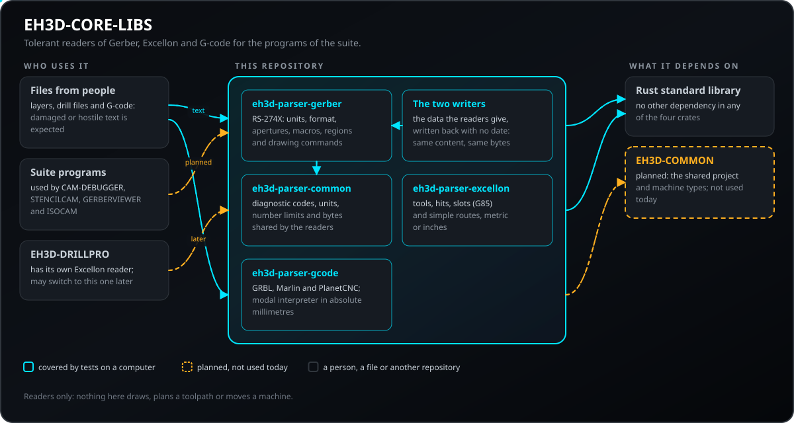
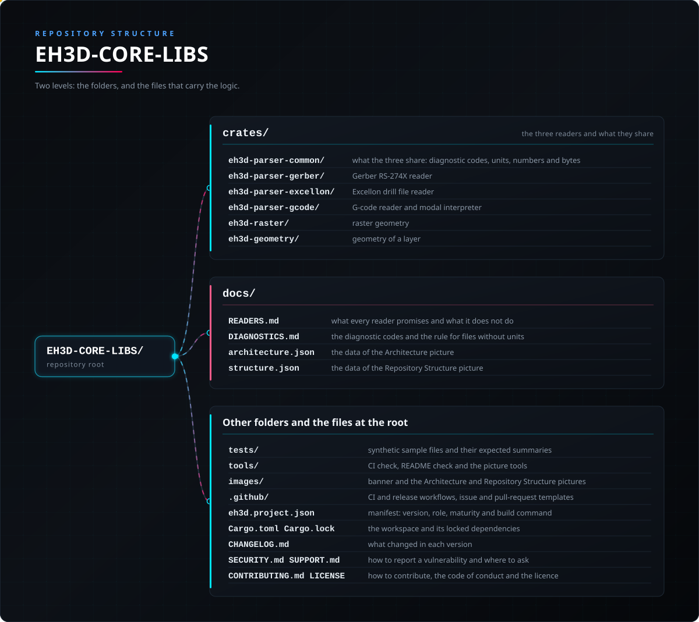

<p align="center">
  
</p>

# 📖 EH3D-CORE-LIBS

<p align="center"><a href="README.md">🇺🇸 English</a> | <a href="README_spa.md">🇪🇸 Español</a> | <a href="README_fra.md">🇫🇷 Français</a> | <a href="README_ita.md">🇮🇹 Italiano</a> | <a href="README_deu.md">🇩🇪 Deutsch</a> | 🇨🇳 <b>中文</b> | <a href="README_jpn.md">🇯🇵 日本語</a> | <a href="README_por.md">🇵🇹 Português</a></p>

### EH3D Fabrication Suite 的读取库：Gerber RS-274X、Excellon 钻孔文件和 G 代码，能容忍损坏的文件

<p align="center">
  
  
  
  
  
</p>

---

**诚实性核对 - 今天真正能运行的内容：** 三个没有依赖的 Rust 库，读取 Gerber（RS-274X）图层、Excellon 钻孔文件和 G 代码（针对 GRBL、Marlin 和 PlanetCNC 方言的模态解释器）。271 个测试在计算机上运行，包括损坏和恶意输入。另有两个库以确定的方式写出 Gerber X2 和 Excellon 文件，不含日期和版本，相同内容总是得到相同字节；它们通过写出再用读取器读回来测试，目前还没有任何查看器或机器打开过它们的文件。读取器不会 panic，并把无法理解的内容作为带行号的诊断报告出来。它们不绘图，不计算刀路，也没有在一批真实生产文件上试过；套件中有四个程序使用它们（EH3D-CAM-DEBUGGER, EH3D-STENCILCAM, EH3D-GERBERVIEWER, EH3D-ISOCAM），这里的内容也从未在机床上运行过。

---

> **安全（safety）与信息安全现状：** 这些库不是安全系统（safety）。它们读取他人可能发来的文件，并用损坏和恶意的输入做过测试，但读取成功的程序**不等于**经过验证的程序：这里不会判断某段 G 代码能否安全地在机床上运行，也从未用它们控制过任何机床。

## 📋 速览

| | |
|---|---|
| 版本 | `0.0.7` |
| 成熟度 | 脚手架 |
| 测试 | 271 |
| 技术栈 | Rust |
| 真实硬件 | 不适用：文件读取库，不与机床通信 |

**跳转到：** [概述](#-概述) · [架构](#-架构) · [快速开始](#-快速开始) · [测试](#-测试) · [结构](#-仓库结构) · [相关项目](#-相关项目)

## 🚦 项目状态

每一行是本仓库的一个部分，灯号表示它今天做到了哪一步。内容依据仓库能够展示的证据（测试、构建、运行），而不是计划。

🟢 已完成并验证 · 🟡 可用，有已知限制 · 🟠 部分完成或尚未验证 · 🔴 未完成或不可用

| 领域 | 状态 | 在这里的含义 |
|---|---|---|
| Gerber 读取器 | 🟡 | RS-274X：读取单位、坐标格式、光圈、宏、区域和绘图命令；目前只用测试文件试过，没有用真实生产文件集合。 |
| Excellon 读取器 | 🟡 | 读取公制或英制的刀具、钻孔、槽孔和简单路径；目前只用测试文件试过。 |
| G 代码读取器 | 🟡 | 针对 GRBL、Marlin 和 PlanetCNC 方言的模态解释器输出绝对毫米坐标（含圆弧）；刀具半径补偿和固定循环会被报告为不支持。 |
| 测试 | 🟡 | 271 个测试通过（`cargo test`）：Gerber 42 个，Excellon 32 个，G 代码 48 个，共用 crate 18 个，栅格几何 17 个，形状 19 个，纯 CAM 56 个，Gerber 写入器 14 个，Excellon 写入器 12 个，包含损坏和恶意输入以及合成文件语料库。 |
| 安全 | 🟡 | 为他人发来的文件而设计：不会 panic，不猜测任何值，问题以带行号的诊断返回；没有独立审查，这里也不判断某段 G 代码能否安全运行。 |
| 几何与 HP-GL | 🔴 | 2D 几何（偏置、布尔运算）以及 HP-GL 和 Bungard 读取器已在计划中，尚未构建。 |
| 被其他程序使用 | 🟡 | 套件中有四个程序依赖这些读取器（EH3D-CAM-DEBUGGER, EH3D-STENCILCAM, EH3D-GERBERVIEWER, EH3D-ISOCAM），都还没有在机床上运行过。 |
| 真实硬件 | 🟡 | 不适用：文件读取库，不与机床通信。 |
| 文档 | 🟡 | 八种语言的 README 和 `docs/READERS.md`，说明每个读取器承诺什么、不做什么；`docs/UNIFICATION.md` 是结束套件中两套读取器的计划（尚未实施）。 |

## 🎯 概述

* **Gerber 读取器**（`eh3d-parser-gerber`，RS-274X）：单位、带零省略的坐标格式、光圈（圆形、矩形、长圆形、多边形）和宏、区域、步进重复以及绘图命令。比其格式更宽的坐标会被拒绝，而不是猜测。
* **Excellon 读取器**（`eh3d-parser-excellon`）：带直径、进给和转速的刀具、钻孔、槽孔（`G85`）和简单路径，支持公制或英制，以及前导或尾随零省略。
* **G 代码读取器和解释器**（`eh3d-parser-gcode`）：字、注释、行号和 Marlin 校验和，以及控制器的模态状态（单位、距离模式、进给、主轴、刀具）。每个运动都以绝对毫米输出（含圆弧），并给出切削长度、快速移动长度和程序的包围盒。
* **栅格几何**（`eh3d-raster`）：长度单位（`8mil`、`0.01in`、`0.2mm`）、网格中每个单元到最近占用单元的精确欧氏距离，以及该距离等于给定值的线（已简化并定向）。
* **图层的形状**（`eh3d-geometry`）：圆盘、矩形、长圆、走线和区域（毫米，y 向上）、它们的包围盒，以及把 Gerber 图层和 Excellon 钻孔文件转换为这些形状（对未绘制的内容都有说明）。
* **纯 CAM**（`eh3d-cam`）：画在网格上的铜箔、带有刀具无法切削间隙检查的隔离路径、强制路径和填充路径、公差与设计规则检查、路径的排序与缩短、基准点对齐、电路板变换、阻焊开窗和旧式 Gerber。它不从磁盘读取文件，也不写 G 代码。
* **用诊断代替失败：** 每个读取器返回带严重程度（信息、警告、错误）和文件行号的条目，并继续读取。
* **计划中：** HP-GL 和 Bungard 读取器以及 2D 几何（偏置和布尔运算）。

## 🧩 在 EH3D 中的角色

EH3D-CORE-LIBS 把文件转换成套件各程序（隔离、钻孔、轮廓、激光和钢网 CAM，以及查看器）使用的数据。它没有界面，也不控制机床。计划使用 EH3D-COMMON 的类型；目前三个读取器各自独立，EH3D-DRILLPRO 仍有自己的 Excellon 读取器。

## 🏛️ 架构

<p align="center">
  
</p>

本仓库各部分如何协作：谁在使用它、它包含什么、它依赖什么。图片由 `docs/architecture.json` 绘制，并与代码核对。

## ✨ 功能

* **零依赖：** 三个 crate 只使用 Rust 标准库。
* **从不 panic：** 测试会给每个读取器输入空文件、二进制乱码、巨大的数字、未结束的注释、数千字符的行，以及有效文件的每一个前缀。
* **不猜测：** 放不进其声明格式的值会作为诊断被拒绝，而不是被舍入成看起来正确的样子。
* **每条命令都知道自己的行号：** Gerber 操作、Excellon 钻孔和 G 代码块都带有它们在文件中的行号。
* **圆弧处理正确：** G 代码解释器支持用 `I`/`J` 或 `R` 指定的圆弧、整圆和绝对圆心，并对不可能存在的圆弧给出报告并按直线绘制。
* **如实说明跳过的内容：** 不支持的功能（刀具半径补偿、固定循环）会报错，该块不产生任何运动；GRBL 的 `$` 系统命令会带说明被跳过。
* **读取器和写入器需要的小功能：** 未定义刀具的孔不再以直径 0 保存，`parse_with_units` 按调用者给出的单位读取钻孔文件，`interpret_with` 在需要时把 `M3 S0` 视为激光关闭，`emit` 模块以唯一的方式写出数字和 G 代码文件的标准文件头，`resolution_warning` 提示相对刀具过粗的网格，`Scene::is_lossy` 说明文件的某些内容不在场景中。

## 🔒 安全与防护

读取器接受任何人提供的文本，因此设计时假定文件可能是粗心或恶意的。每一行都有测试。

| 威胁 | 防御 |
|---|---|
| 损坏、被截断或二进制的文件 | 不 panic：任何文本都会得到结果；测试会在每个位置截断有效文件，并输入乱码 |
| 对其声明格式而言过宽的数字，或荒谬的值 | 以 `Error` 诊断拒绝，绝不舍入或截断成看似合理的值 |
| 单行极长的文本 | G 代码读取器在 512 个字符处截断该行（`MAX_LINE_CHARS`）并加以说明 |
| 解释器没有建模的 G 代码功能（刀具半径补偿、固定循环） | 报 `Error` 诊断，该块不产生任何运动，因此程序不会被悄悄误读 |
| 损坏的 Marlin 行 | 校验和会被验证，错误的会被报告 |
| 不可能存在的圆弧（半径小于弦长的一半） | 报告并按直线绘制 |
| 不安全的内存使用 | 读取器是没有依赖、可全面审阅的安全 Rust |

**没有防御的内容：** 读取干净的程序不等于经过验证的程序。这里不检查机床限位、刀具长度或碰撞，读取器也未经独立审查。请私下报告漏洞（见 [SECURITY.md](SECURITY.md)）。

## 🔌 接口

| Crate | 入口 | 结果 |
|---|---|---|
| `eh3d-parser-gerber` | `parse(text)`、`decode_coordinate(text, format)` | `GerberFile`：单位、格式、光圈、宏、属性、`commands`、`ended`、`diagnostics` |
| `eh3d-parser-excellon` | `parse(text)`、`decode_coordinate(...)` | `ExcellonFile`：单位、零省略、`tools`、`drills`、`slots`、`routes`、`ended`、`diagnostics` |
| `eh3d-parser-gcode` | `parse(text, dialect)`，然后 `interpret(&program)` | `Program`（块）和 `Trace`（毫米线段、包围盒、切削与快速移动长度） |
| `eh3d-raster` | `parse_length(text, bare_unit)`、`distance_mm(on, w, h, res)`，然后 `loops(&grid, level)` | `Unit`、每个单元的毫米距离和以毫米表示的闭合路径（`Loop`） |
| `eh3d-geometry` | `from_gerber(&file)`、`from_excellon(&file)`，然后 `scene.bounds()` | `Scene`（`Shape` 和说明）以及毫米的 `Bounds` |
| `eh3d-cam` | `from_scene(&scene, margin, res)`，然后 `plan(&scene, &plan)` 和 `close_pieces(...)` | `Bitmap`、`Pass`（以毫米表示的闭合和开放路径）、`Hole` 以及各项检查的结果 |

三者共用 `Diagnostic { line, severity, code, message }`（`Severity` 为 `Info`、`Warning` 或 `Error`），以及用来询问是否发现 `Error` 的 `is_clean()`。没有命令行程序，没有网络访问，也没有文件访问：调用方传入文本，得到数据。 每条诊断都有稳定的 `code`（列于 `docs/DIAGNOSTICS.md`），可按类型而不是按文字过滤。`parse_bytes` 从字节读取文件并限制大小（257 MiB），不是 UTF-8 的文本会带警告按 Latin-1 读取。没有单位的 Gerber 或 Excellon 文件按毫米读取，并给出警告 `units-missing`。共用类型位于内部 crate `eh3d-parser-common`，各读取器会重新导出。

## ⚙️ 配置

读取器没有配置文件。调用方可以选择的内容和固定的限制如下：

| 值 | 范围 | 位置 |
|---|---|---|
| G 代码方言 | `Grbl`、`Marlin` 或 `PlanetCnc` | `parse` 的第二个参数 |
| G 代码单行长度 | 最多 512 个字符；超出部分被截断并报告 | `crates/eh3d-parser-gcode/src/lib.rs` 中的 `MAX_LINE_CHARS` |
| 单位 | 取自文件（Gerber 的 `MO`，Excellon 的 `METRIC` 或 `INCH`，G 代码的 `G20`/`G21`）；G 代码输出始终为毫米 | 读取器 |
| 坐标格式 | 取自文件（Gerber 的 `FS`，Excellon 的 `FILE_FORMAT=i:d` 或文件头）；更宽的值是错误 | 读取器 |
| 零省略 | 前导或尾随，按文件所述 | 读取器 |

## 🚀 快速开始

需要稳定版 Rust 工具链（1.75 或更高）。

```rust
use eh3d_parser_gcode::{interpret, parse, Dialect};

fn main() {
    let program = parse("G21\nG90\nG1 X10 Y0 F300\nM2\n", Dialect::Grbl);
    let trace = interpret(&program);
    println!("{} mm of cut, clean: {}", trace.cutting_length_mm, program.is_clean());
}
```

```bash
cargo build --release
cargo test
cargo clippy --all-targets -- -D warnings
cargo fmt --check
python -I tools/ci_validate.py
```

## 🧪 测试

测试共 271 个（`cargo test`，CI 中在 Windows 和 Linux 上运行）：Gerber 42 个、Excellon 32 个、G 代码 48 个、共用 crate 18 个，栅格几何 17 个，形状 19 个，纯 CAM 56 个、Gerber 写入器 14 个、Excellon 写入器 12 个。由 21 个小型合成文件组成的语料库（`tests/golden/`：英寸和毫米的 Gerber、带 `LZ`/`TZ`、槽孔和路径的 Excellon、面向 GRBL、Marlin 和 LinuxCNC 的 G 代码，含 CRLF、Latin-1 和损坏文件）由各读取器读取，并与每个文件旁保存的摘要比较；`EH3D_REGENERATE=1 cargo test` 会重写摘要，使变化在 diff 中可见，同样的文件还会被变异测试以数千种方式破坏。它们检查：典型的铜层和典型的公制文件能被完整读取、省略的坐标、两种零省略、槽孔、路径、英寸换算为毫米、每条命令都知道自己的行号、按圆心和按半径指定的圆弧、整圆、模态进给与运动、Marlin 校验和、不支持的功能被报告而不是猜测，以及损坏的输入：乱码、被截断的前缀和超长的行都不会 panic。CI 还运行 `cargo fmt --check`、将警告视为错误的 `cargo clippy` 以及 `python -I tools/ci_validate.py`。

## 🏗️ 构建与发布

版本号位于 `Cargo.toml`（工作区）、`eh3d.project.json`，并通过工作区体现在三个 crate 中；每个版本在 [CHANGELOG.md](CHANGELOG.md) 中都有条目。版本发布在 GitHub 上；这些 crate 从本仓库使用，不在 crates.io 上。

## 📂 仓库结构

<p align="center">
  
</p>

<details>
<summary>目录树的文本版</summary>

```text
EH3D-CORE-LIBS/
├── crates/
│   ├── eh3d-parser-common/                      三者共用的部分：诊断代码、单位、数字和字节
│   ├── eh3d-parser-gerber/                      Gerber RS-274X 读取器
│   ├── eh3d-parser-excellon/                    Excellon 钻孔文件读取器
│   ├── eh3d-parser-gcode/                       G 代码读取器和模态解释器
│   ├── eh3d-raster/                             栅格几何
│   ├── eh3d-geometry/                           图层几何
│   ├── eh3d-cam/                                纯 CAM
│   ├── eh3d-writer-gerber/                      Gerber X2 写入器
│   └── eh3d-writer-excellon/                    Excellon 写入器
├── docs/                                        READERS.md：每个读取器的承诺和不做的事，DIAGNOSTICS.md：诊断代码，以及两张图的数据
├── tests/                                       合成示例文件及其预期摘要
├── tools/                                       CI 和 README 检查及绘图工具
├── images/                                      横幅图以及架构和仓库结构图片
├── .github/                                     CI 与发布工作流、Issue 和 PR 模板
├── eh3d.project.json                            清单：版本、角色、成熟度和构建命令
├── Cargo.toml Cargo.lock                        工作区及其锁定的依赖
├── CHANGELOG.md                                 每个版本的变更
├── SECURITY.md SUPPORT.md                       如何报告漏洞及在哪里提问
└── CONTRIBUTING.md CODE_OF_CONDUCT.md LICENSE   参与贡献、行为准则和许可证
```

</details>

## 🗺️ 路线图与已知限制

**目前已知的限制**

* 读取器只用测试文件试过，没有用一批真实生产文件试过。
* 刀具半径补偿（`G41`/`G42`）和固定循环（`G81`..`G89`）是错误；刀具长度补偿、探测循环、`G28`/`G30` 和工件坐标系会被读取，但不跟踪它们对位置的影响；圆弧仅限 XY 平面。
* HP-GL、Bungard 格式和 2D 几何（偏置和布尔运算）尚未构建。
* 套件中有四个程序使用这些读取器，都还没有在机床上运行过，读取器也未经独立审查。

**下一步**

* 用一批真实文件试用这三个读取器，并修复发现的问题。
* 构建 2D 几何（偏置和布尔运算）以及 HP-GL 和 Bungard 读取器。
* 让 EH3D-DRILLPRO 和各 CAM 程序使用这些读取器，而不是各自的实现。

## 🌍 语言

README 和文本提供英语、西班牙语、法语、意大利语、德语、汉语、日语和欧洲葡萄牙语版本。

## 🔗 相关项目

* [EH3D-COMMON](https://github.com/JuanenRac/EH3D-COMMON)：套件的项目容器和机床类型；已发布
* [EH3D-DRILLPRO](https://github.com/JuanenRac/EH3D-DRILLPRO)：钻孔程序；目前有自己的 Excellon 读取器
* [EH3D-ISOCAM](https://github.com/JuanenRac/EH3D-ISOCAM)：计划中：基于 Gerber 读取器的隔离铣削
* [EH3D-CAM-DEBUGGER](https://github.com/JuanenRac/EH3D-CAM-DEBUGGER)：计划中：对这些读取器所解释的 G 代码做仿真

## 📚 文档

* [每个读取器的承诺](docs/READERS.md)：保证、诊断以及不做的事。
* [Gerber 和 Excellon 各用一个读取器](docs/UNIFICATION.md)：计划（尚未实施）：本仓库与 EH3D-COMMON 的读取器如何合而为一。
* [变更日志](CHANGELOG.md)

## 🤝 参与贡献与社区

* 提交 pull request 之前请运行 `cargo fmt --check`、`cargo clippy --all-targets -- -D warnings`、`cargo test` 和 `python -I tools/ci_validate.py`，全部通过。参见 [CONTRIBUTING.md](CONTRIBUTING.md) 和[行为准则](CODE_OF_CONDUCT.md)。
* README 有八种语言：修改文字时要同步修改全部八个文件，两张图片由 `tools/make_architecture.py` 和 `tools/make_structure.py` 根据 `docs/architecture.json` 和 `docs/structure.json` 绘制。
* 读取器绝不能 panic，也绝不能猜测：新增情形需要带损坏输入的测试，不支持的功能要报告，而不是悄悄跳过。
* 请私下报告漏洞：[SECURITY.md](SECURITY.md)。问题、想法和报告：electrohobby3d@gmail.com（[SUPPORT.md](SUPPORT.md)）。

## 👤 作者

**JuanenRac (Electro Hobby 3D)** · electrohobby3d@gmail.com

## 📜 许可证

软件：GPL-3.0-or-later。见 [LICENSE](LICENSE)。套件的硬件设计使用 CERN OHL-S。
